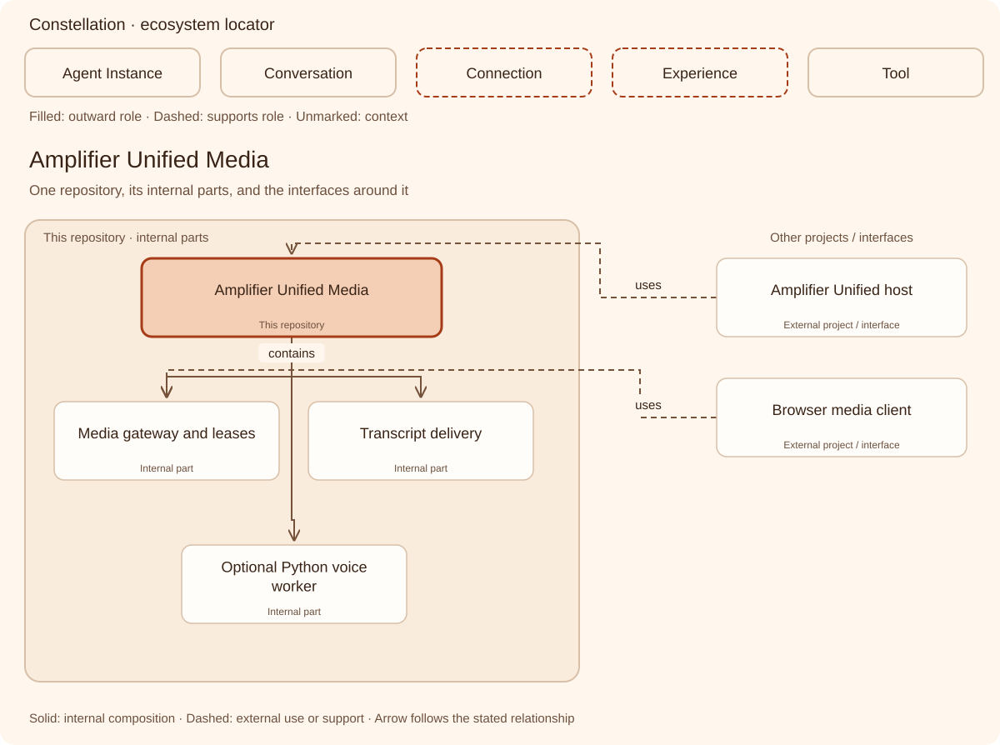

# Unified media capability

Add voice conversations, transcript delivery and explicitly authorized visual
capture to an Amplifier Unified host. The package connects browser media and an
optional Python voice worker to the host's existing sessions and provider setup.
It is an integration library, not a standalone voice app.

## Get started

Use Node.js 22+ and a configured host. Voice transport also needs Python 3.11+,
uv and an appropriate provider account. From a checkout:

```sh
npm ci
uv sync --extra openai
```

Install the checkout into your host project with
`npm install /absolute/path/to/amplifier-unified-capability-media`.
Then compose the provider with your own authenticated host callbacks:

```js
import {createMediaCapability} from '@amplifier/unified-media-capability';

const media = await createMediaCapability({
  directory: '/absolute/private/media',
  inspectSession,
  delegate,
  recordTranscript,
  settings,
  resolveCredential,
  python: '/absolute/venv/bin/python',
  pythonMode: 'installed',
});
```

Use the Python executable from the prepared environment (`Scripts/python.exe` on
Windows). The named functions above are integration callbacks, not globals
provided by this package. `inspectSession` supplies bounded session context,
`delegate` submits through normal host admission, and `recordTranscript` uses the
native transcript writer. `settings` returns sanitized availability; only
`resolveCredential` supplies the private credential for an explicit call or preview.

Register `manifest`, `read`, `action` and `resourceProvider` with the host.
Mount `handleMedia` at `/media/*` before static routing, with authenticated account
and origin context, and call `await media.close()` at shutdown. A Fetch adapter
is also available. See [integration requirements](docs/integration.md) and the
[factory implementation](src/index.js) for the callback and HTTP boundaries.

## Permissions and privacy

Browser audio uses WebRTC. Device selection, mute and playback stay client-owned.
Screen capture requires an explicit, temporary client/session permission; there
is no background capture or automatic replay after restart. Native foreground
observation is opt-in and does not grant desktop control.

Configured credentials do not prove provider-account access. A lost call response
remains uncertain; the integration must not automatically start another call.
Keep private media records separate from native session history.

For development, see the [media contract](contracts/media.v1.md) and [AGENTS.md](AGENTS.md).


<!-- ecosystem-map:start -->
## Where this fits

An optional media capability inside a composed Amplifier Unified host.

Supports: Experience, Connection.



[Product page](https://microsoft.github.io/amplifier-constellation/projects/amplifier-unified-capability-media/) · [Open the map](docs/ecosystem-map.svg) · [Map guide](https://github.com/microsoft/amplifier-constellation/blob/main/docs/ecosystem-maps.md)

<details>
<summary>The five shared building blocks</summary>

[](https://microsoft.github.io/amplifier-constellation/)

</details>

<!-- ecosystem-map:end -->

## Contributing

Most contributions require you to agree to a
Contributor License Agreement (CLA) declaring that you have the right to, and actually do, grant us
the rights to use your contribution. For details, visit [Contributor License Agreements](https://cla.opensource.microsoft.com).

When you submit a pull request, a CLA bot will automatically determine whether you need to provide
a CLA and decorate the PR appropriately (e.g., status check, comment). Simply follow the instructions
provided by the bot. You will only need to do this once across all repos using our CLA.

This project has adopted the [Microsoft Open Source Code of Conduct](https://opensource.microsoft.com/codeofconduct/).
For more information see the [Code of Conduct FAQ](https://opensource.microsoft.com/codeofconduct/faq/) or
contact [opencode@microsoft.com](mailto:opencode@microsoft.com) with any additional questions or comments.

## Trademarks

This project may contain trademarks or logos for projects, products, or services. Authorized use of Microsoft
trademarks or logos is subject to and must follow
[Microsoft's Trademark & Brand Guidelines](https://www.microsoft.com/legal/intellectualproperty/trademarks/usage/general).
Use of Microsoft trademarks or logos in modified versions of this project must not cause confusion or imply Microsoft sponsorship.
Any use of third-party trademarks or logos are subject to those third-party's policies.
